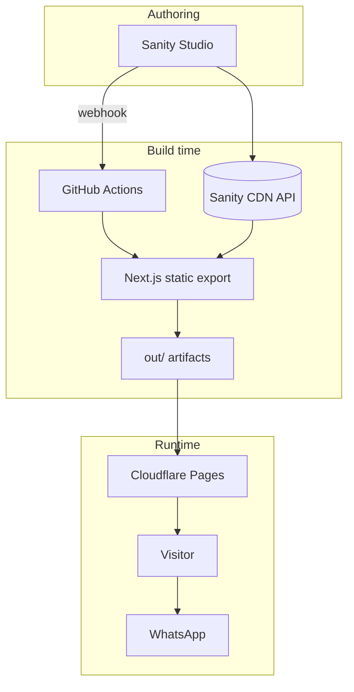

# Architecture Spine — Serendib Global Auto Stage 1

## Design Paradigm

**Static site generator + headless CMS** (build-time content projection).

| Layer | Responsibility |
|--------|----------------|
| **Presentation** | Next.js App Router pages, React components, Tailwind |
| **Content access** | `src/content/` — Sanity fetch, GROQ, DTO mapping |
| **Messages** | `messages/en.json`, `messages/si.json` for UI chrome |
| **Authoring** | Sanity Studio (`studio/`) |
| **Delivery** | Static `out/` → Cloudflare Pages |

No runtime origin server in Stage 1.

## Invariants & Rules

### AD-1 — Static export only [ADOPTED]

- **Binds:** RULE-1, FR-60, FR-61
- **Prevents:** Cloudflare Workers SSR, API routes, server actions for enquiries
- **Rule:** `next.config` uses `output: 'export'`. No `route.ts` API handlers, no `dynamic = 'force-dynamic'` on public pages.

### AD-2 — Content boundary

- **Binds:** FR-66, all Sanity reads
- **Prevents:** GROQ in page components, Sanity types leaking into UI
- **Rule:** UI imports only from `content/` typed functions, e.g. `getVehicles(locale)`, `getVehicleBySlug(locale, slug)`.

### AD-3 — Locale in URL

- **Binds:** FR-20–FR-22, EXPERIENCE IA
- **Prevents:** Cookie-only locale invisible to crawlers
- **Rule:** Routes under `app/[locale]/…` with `locale ∈ {en, si}`. Redirect `/` → `/en`. `generateStaticParams` emits both locales for CMS-backed routes.

### AD-4 — CMS localization shape [ADOPTED]

- **Binds:** D-10, FR-39, FR-23
- **Prevents:** Runtime machine translation
- **Rule:** CMS fields use `{ en, si? }` objects; resolver returns active locale with English fallback. UI strings from `next-intl` message files only.

### AD-5 — Sanity access at build time

- **Binds:** FR-61, FR-62, FR-40
- **Prevents:** Client-side live catalogue fetch in production
- **Rule:** Fetch published documents during build; vehicle slugs drive `generateStaticParams`.

### AD-6 — No secrets in client

- **Binds:** RULE-5, FR-65
- **Prevents:** Write tokens in bundle or repo
- **Rule:** Sanity project ID/dataset via env at build; no write tokens in client; never commit token `.env`.

### AD-7 — Deploy triggers (dual) [ADOPTED]

- **Binds:** D-11, FR-64a, FR-64b
- **Prevents:** Owner blocked when webhook fails
- **Rule:** Sanity publish → webhook → CI/build hook; plus GitHub `workflow_dispatch` manual rebuild. Document in `docs/ops-deploy.md`.

### AD-8 — Enquiry is client-only

- **Binds:** FR-25–FR-27, RULE-4
- **Prevents:** Accidental form POST endpoints
- **Rule:** Validate client-side; open `wa.me`, `tel:`, or `mailto:` only.

### AD-9 — UX design tokens

- **Binds:** DESIGN.md (approved)
- **Prevents:** Visual drift from signed-off UX
- **Rule:** Tailwind theme from DESIGN.md; logo `public/brand/sga_small_logo.jpg`; micro-radius containers; pill language switch.



## Consistency Conventions

| Concern | Convention |
|---------|------------|
| Naming | Sanity types PascalCase; slugs kebab-case |
| Locales | `en`, `si`; URL prefix required |
| Money | LKR in CMS; missing price → message key POA |
| Images | `@sanity/image-url` at build |
| Config | `SITE_URL=https://serendibglobalauto.lk` |

## Stack

| Name | Version / note |
|------|----------------|
| Node.js | 20 LTS |
| Next.js | 15.x, `output: 'export'` |
| TypeScript | 5.x strict |
| Tailwind CSS | Pin at scaffold |
| Sanity | v3; project `n2zalqm8` / `production` |
| next-intl | `[locale]` routing |
| Cloudflare Pages | Static host |
| GitHub Actions | lint, typecheck, build |

## Structural Seed

```text
sga-headless/
  src/app/[locale]/
  src/components/
  src/content/
  messages/en.json
  messages/si.json
  public/brand/sga_small_logo.jpg
  studio/
  .github/workflows/ci.yml
  docs/ops-deploy.md
```

## Capability → Architecture Map

| Capability | Lives in | Governed by |
|------------|----------|-------------|
| Pages FR-1–6 | `app/[locale]/*` | AD-3, AD-9 |
| Catalogue FR-10–17 | `vehicles/`, `content/vehicles.ts` | AD-2, AD-5 |
| i18n FR-20–24 | `messages/*`, resolvers | AD-3, AD-4 |
| Enquiry FR-25–29 | `components/enquiry` | AD-8 |
| CMS FR-35–42 | `studio/schemas` | AD-5, AD-6 |
| CI/CD FR-63–64b | `.github/workflows` | AD-7 |

## Deferred

D1/R2/Workers, enquiry CRM, Tamil, ISR, paid services without approval.