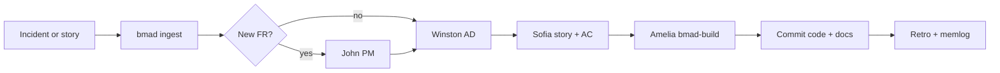

# BMAD way of working — SGA Stage 1 (`sga-headless`)

This project delivers **initiative sga-stage-1** using the **BMAD Method**: skills in Cursor, artifacts under `_bmad-output/`, and runtime scripts in `_bmad/scripts/`. Engineering and operations changes should follow the loop below—not ad hoc fixes in chat only.

**Initiative hub:** [`_bmad-output/initiative-sga-stage-1/initiative-sga-stage-1.md`](../_bmad-output/initiative-sga-stage-1/initiative-sga-stage-1.md)

---

## Prerequisites

| Tool | Purpose |
|------|---------|
| **[uv](https://docs.astral.sh/uv/)** | Runs `_bmad/scripts/*` and skill entrypoints (`render_skill.py`, `setup.py`, `memlog.py`, …) |
| **BMAD skills** | Project: `.agents/skills/`; optional global: `~/.agents/skills/` |
| **`_bmad/`** | Hub config (`config.toml`) + shared scripts (refreshed by `bmad setup`) |

**Install uv (macOS):**

```bash
curl -LsSf https://astral.sh/uv/install.sh | sh
# Add to shell profile:
export PATH="$HOME/.local/bin:$PATH"
uv --version
```

**Refresh BMAD scripts (after skill updates):**

```bash
cd /path/to/sga-headless
uv run --no-cache ~/.agents/skills/bmad/scripts/setup.py \
  --project-root . \
  --skill ~/.agents/skills/bmad \
  --root .agents/skills \
  --root ~/.agents/skills
```

**Health check:**

```bash
uv run --no-cache ~/.agents/skills/bmad/scripts/setup.py \
  --project-root . --skill ~/.agents/skills/bmad --status
```

Expect `"current": true` and `"shared_scripts": "current"`.

**Render a skill workflow (what agents auto-follow when `uv` works):**

```bash
uv run --no-cache _bmad/scripts/render_skill.py \
  --project-root . \
  --skill .agents/skills/bmad-build
```

Optional: `--set workflow.route=oneshot` or `workflow.review=quick` where the skill supports it.

---

## Artifact layout (this initiative)

```text
_bmad-output/initiative-sga-stage-1/
  brief-sga-stage-1/
  prd-sga-stage-1/              ← FRs (e.g. FR-64a/b)
  ux-sga-stage-1/               ← DESIGN.md, EXPERIENCE.md
  architecture-sga-stage-1/     ← AD-1 … AD-9
  sources/ingest/               ← incidents & meeting/thread notes
  tickets/
    epic-foundation/
    epic-sanity-studio/
    epic-site-chrome-pages/
    epic-vehicles/              ← Epic 4
    epic-enquiry-deploy/        ← Epic 5
  .memlog.md                    ← initiative decision log
```

**Repo runbooks (not BMAD, but bound by AD-7):** [`docs/ops-deploy.md`](ops-deploy.md) (CI/CD, Cloudflare, webhooks).

---

## Team roles (invoke in Cursor)

| Role | Say / skill | Output |
|------|-------------|--------|
| Router | `bmad` | Next skill, setup help |
| Analyst | `Mary` / `bmad-agent-analyst` | Research, briefs |
| PM | `John` / `bmad-agent-pm` | PRD (only when FRs change) |
| Architect | `Winston` / `bmad-architecture` | `architecture-sga-stage-1.md`, AD-* |
| UX | `Sally` / `bmad-ux` | DESIGN / EXPERIENCE |
| PO | `Sofia` / `bmad-agent-po` | `tickets/tickets.toml`, ACs |
| Dev | `Amelia` / `bmad-build` | Code + `plan-*.md` |
| Auto dev | `bmad-build-auto` | Unattended build loop |
| Ingest | `bmad ingest — …` | `sources/ingest/YYYY-MM-DD-*.md` |
| Retro | `bmad-retrospective on epic-…` | `RETROSPECTIVE.md` |
| Review | `bmad-code-review` | Triage findings |
| Project context | `bmad-project-context` | `AGENTS.md` conventions |

Skills with a `render_skill.py` step expect **`uv`** on `PATH`; if render fails, agents fall back to reading `.agents/skills/<skill>/workflow.md` manually—prefer fixing `uv` first.

---

## Standard loop (features, bugs, incidents)



1. **Ingest** — `sources/ingest/<date>-<slug>.md`: symptom, causes, fixes, verification, traceability (FR, AD, epic).
2. **Architecture** — Update AD-* only for **durable rules** (not one-off typos).
3. **PO** — Story in `tickets/epic-*/tickets/tickets.toml` with testable ACs.
4. **Build** — `bmad-build` → plan in epic folder → implement → lint/build → plan `status: done`.
5. **Retro** — When closing an epic or major incident: `RETROSPECTIVE.md` + acceptance decision.
6. **Memlog** — One line in `initiative-sga-stage-1/.memlog.md` and architecture `.memlog.md` when decisions land.
7. **Git** — Commit `_bmad-output` **with** application changes.

**Team handoff:** Share links to **ingest + retro + ops-deploy**, not long chat logs.

---

## Prompt cheat sheet

| Intent | Example |
|--------|---------|
| Router | `bmad — what's next for epic 5?` |
| Incident | `bmad ingest — <title>: <one-line summary>` |
| AD update | `Winston — paragraph under AD-7 for …` |
| Story | `Sofia — story under epic-enquiry-deploy for …` |
| Implement | `Amelia implement via bmad-build — epic … story id N` |
| Hygiene | `BMAD hygiene — sync ingest, AD, retros, memlog, docs` |
| Epic done | `bmad-retrospective on epic-vehicles` |

---

## CI/CD & ops (canonical for Stage 1)

Documented in AD-7 and [`ops-deploy.md`](ops-deploy.md):

| Component | Role |
|-----------|------|
| **CI** (`ci.yml`) | **Pull requests only** — lint, typecheck, build |
| **Rebuild site** (`rebuild.yml`) | **`main`**, manual, Sanity webhook — build + Pages deploy |
| **Pages** `sga-headless` | Public site (`*.pages.dev` / custom domain) |
| **Worker** `sga-sanity-rebuild` | Webhook relay only |

Do **not** use a Git-connected **Worker** named `sga-headless` for the marketing site.

---

## Incidents already on record (examples)

Use these as templates for future ingest:

| Topic | Ingest |
|-------|--------|
| Empty catalogue, detail OK | `sources/ingest/2026-11-24-prod-catalogue-detail-mismatch.md` |
| Webhook ran, vehicle missing, CI dedupe | `sources/ingest/2026-11-24-webhook-rebuild-stale-cdn-cicd.md` |

Related epics: **4** (vehicles, AD-5), **5** (deploy/webhook, AD-7).

---

## What must go through BMAD

| Through BMAD | Skip ceremony |
|--------------|----------------|
| Features, bugs, deploy behaviour | Typo-only / formatting-only |
| Production incidents | Pure local experiments (until lesson worth ingesting) |
| Deploy / webhook / CMS build rules | — |
| Epic closure | — |

---

## BMAD hygiene checklist

After a shipping week or incident batch:

- [ ] New or updated **ingest** notes under `sources/ingest/`
- [ ] **Architecture** / **AD-*** aligned with code
- [ ] **Stories** and ACs in `tickets.toml`
- [ ] **Retrospectives** if epics moved toward done
- [ ] **`.memlog.md`** entries (initiative + architecture)
- [ ] **`docs/ops-deploy.md`** if ops changed
- [ ] **`uv` + `bmad setup`** if skills were updated (`shared_scripts` not stale)
- [ ] **Commit** `_bmad-output` and `docs/` with application code

---

## Further help

- Ask **`bmad`** in Cursor for module status or next step.
- Method module skills live under `.agents/skills/bmad-*` (project) and `~/.agents/skills` (global duplicates are OK; project copy wins when both exist).